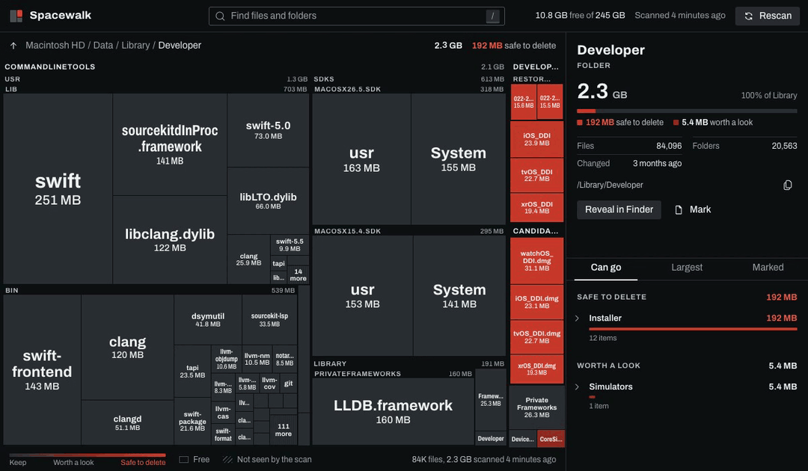

# [Spacewalk](https://github.com/nicolasdmolina/spacewalk-map)

A live, read-only map of your Mac’s disk that shows where you can free up space.



Each tile is sized by the space it takes on disk. Gray means keep, dark red means check first, and bright red marks things you can usually replace, such as caches and installers. The recording shows `/Library/Developer` on a Mac mini.

Click a folder to look inside. Hover over a tile for its size, or search for a file by name. **Can go** groups suggestions by kind. **Largest** lists the biggest files in the folder you’re viewing. The map also accounts for free space and shows a hatched area for space the scan couldn’t see.

## Read-only by design

Spacewalk reads file names, paths, sizes, and dates. It never reads file contents or changes the files it scans. **Mark** saves a path for later. **Reveal in Finder** takes you to the item if you decide to remove it yourself.

Scan snapshots stay in `~/Library/Caches/Spacewalk/`. Marked paths stay in `~/Library/Application Support/Spacewalk/`. By default, only a browser on your Mac can connect.

## Install and run

You need a Mac with an APFS startup disk, Node.js 22.12 or later with npm, and Apple’s Command Line Tools. The first run needs an internet connection to download the web app’s packages.

If you need the Command Line Tools, run `xcode-select --install` and finish the macOS installer. You can install Node.js with `brew install node` if you use Homebrew.

```sh
git clone https://github.com/nicolasdmolina/spacewalk-map.git
cd spacewalk-map
./bin/spacewalk
```

Spacewalk builds the scanner, opens [the map on your Mac](http://127.0.0.1:4747/), and fills it in as the scan runs. Press **Control-C** in Terminal to stop. To open it again, run `./bin/spacewalk` from the same folder.

To view the map from another device on your Tailscale network, run `./bin/spacewalk --tailnet` and open the private address it prints. Devices that can reach it can see file names and paths.
